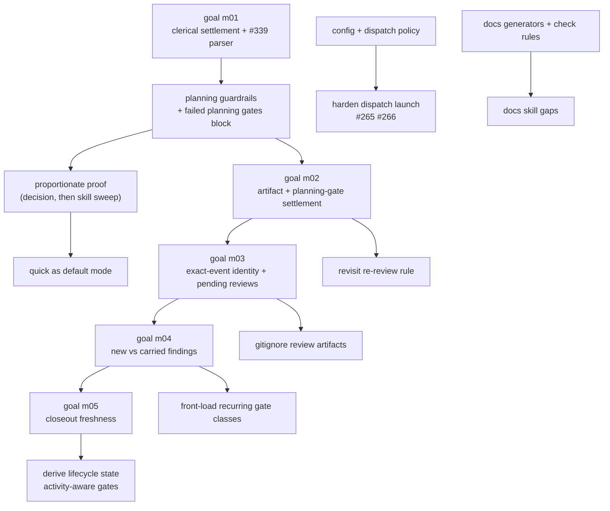

# Roadmap

This file records prioritized direction and lives under `pjm/` (the operational
layer). To reduce cross-worktree conflicts, prefer adding or moving single
bullet lines over rewriting whole sections. Backlog references include the ID
and title so this map remains readable without a board lookup.

**Last rewritten:** 2026-11-02, after a full backlog triage with the operator.
That triage closed 35 items, merged 3 into other items, narrowed 7 to their
core, and recorded operator decisions on 13. It took the open backlog from 122
items to 84. It replaces the wave numbering proposed by the
[2026-10-31 backlog and roadmap review](backlog/reviews/backlog-and-roadmap-review.md),
whose Waves 0 and 1 shipped (#393, #395). The remaining waves are folded into
the named tracks below. [priority-alignment.md](backlog/reviews/priority-alignment.md)
is the compact execution guide. Shipped and closed history lives in
[backlog/completed.md](backlog/completed.md) and
[project summaries](../reference/project-summaries/).

## Now (Active / Committed)

<!-- Add active work here. Format:
- **BL-YYMMDD-slug: {title}** — brief description. Project: {name} (if linked)
-->

- **`review-gate-integrity-goal` (goal project; m01 merged in #400, m02 re-alignment next):** one integrity model for reviews and gates, delivered as five milestones, each its own PR. Later milestones are re-aligned after each delivery. Project: review-gate-integrity-goal.
  - m01: **BL-260711-skip-re-review-for-bookkeeping: Skip re-review for bookkeeping-only review findings** (urgent) and the #339 parser slice of **BL-261003-diagnose-review-finding: Diagnose review finding overcounts and revalidate format-only repairs**.
  - m02: settles artifact reviews and planning-skill gates (plan, quick-start, import-plan, lite, brief, goal).
  - m03: **BL-260820-emit-source-qualified: Emit source-qualified provenance envelopes for review and gate receipts**, **BL-260820-bind-each-gate-review: Bind each gate review disposition to its exact received ledger event** and **BL-261002-list-pending-required-reviews: List pending required reviews when a project reaches a pull request**.
  - m04: **BL-260927-mark-gate-findings-as-new-or: Mark gate findings as new or carried over between attempts** and **BL-261013-classify-review-findings: Classify review findings against the contract at every receive**.
  - m05: **BL-260820-track-pr-closeout-evidence: Track PR-closeout evidence freshness against the current head**. It now also owns the post-closeout docs-sync staleness merged in from BL-261013-documentation-sync-after.
- **Config and dispatch policy (beside the goal; touches no goal files):**
  - **BL-261002-settle-dispatch-policy: Settle dispatch policy precedence and stop legacy presets overwriting ladder columns** and **BL-261002-make-the-copy-sync-strategy: Make the copy sync strategy checkout-independent and settable from the CLI**, in parallel.
  - **BL-261002-fix-oat-config-describe-gaps: Fix oat config describe gaps and make config unset reach the layer that holds the key**, after both.
  - **BL-260726-validate-cursor-pin-effort: Validate Cursor pin effort rungs at sync time**, independent.
- **Small adopter-facing fixes (single-lane PRs, any time):**
  - **BL-261102-quote-the-oat-project-pause: Quote the oat project pause reason so YAML parses it intact**
  - **BL-261102-let-pr-skills-fall-back: Let PR skills fall back to origin/HEAD when git.defaultBranch is unset**
  - **BL-261002-provide-a-complete-oat: Fix oat tools remove --all at project scope and drop stale requiredBy entries**
  - **BL-260927-give-gate-receipts-portable: Ship the gate-receipts ignore rule from oat init and make gate receipt paths repository-relative**
  - **BL-261002-decide-first-run-defaults: Decide first-run defaults for project scope without origin and non-interactive pack install**: decided to fall back to local scope and install core only.
  - **BL-261030-decide-whether-a-no-op-sync: Decide whether a no-op sync should restamp the manifest oatVersion**: decided no restamp.
- **In review:** the pntr slice of **BL-261024-roll-out-the-shipped-oat-docs: Roll out the shipped OAT docs front door and approval policy to consumer repositories** (voxmedia/pntr#87), and **BL-261002-publish-an-owner-statement: Publish an owner statement on project stability, support, and non-goals** (docs PR; the operator still has to confirm the non-goals).

## Next (Planned)

<!-- Add planned work here. Format:
- **BL-YYMMDD-slug: {title}** — brief description. Project: {name} (if linked)
-->

- **Planning guardrails (now, in the window after goal m01 merged and before m02 starts):** these edit the discover, quick-start, plan, brief, goal and implement skills that m01 and m02 also edit.
  - **BL-260830-make-documentation-aware: Make the knowledge index optional by default for discovery and planning** and **BL-261003-reconcile-oat-tracking-commit: Reconcile OAT tracking commit cadence with resumable phase/group batching**, in parallel.
  - **BL-261002-warn-when-the-default-branch: Warn when the default branch has changed planned paths since the branch base** and **BL-261002-add-an-explicit-plan-approval: Add an explicit plan-approval step to quick and spec-driven projects**, together after the first two.
  - **BL-261002-offer-a-strict-gate-reviewer: Keep failed planning gates blocking and align gate wording and decision records**: coordinate with m02, which settles gates in the same planning skills. Close it against m02 if m02 delivers the blocking rule.
- **Proportionate proof across all modes:** **BL-260906-re-evaluate-universal-plan: Re-evaluate universal plan proof strategy and test-first guidance**. The operator decided to replace test-first as the default because current guidance produces overkill testing. Record the universal decision first, extending `DR-260906-use-proportionate-proof`. Then run the skill and template sweep after the planning guardrails, since it touches the same skills.
- **Quick as the default mode:** **BL-260904-make-quick-the-default-oat: Make quick the default OAT workflow mode and spec-driven the explicit larger mode**. Decided; same skill surface, so sequence it with or after the proof sweep.
- **Docs tooling:**
  - **BL-261025-make-oat-docs-generators: Make OAT docs generators and writers predictable** (the `generate-index --check` and stdout slice first) and **BL-261025-tighten-oat-docs-check-rules: Tighten oat docs check rules and diagnostics**. Both are disjoint from the goal.
  - **BL-261025-close-docs-skill-workflow-gaps: Close docs skill workflow gaps found in the consumer rollout**, after the generator slice.
- **BL-260906-harden-dispatch-launch: Harden dispatch launch baselines and terminal reconciliation**: after config and dispatch policy settles. #265 first needs a decision on where the git seam may live; #266 needs an outcome matrix.
- **BL-261002-enforce-remote-planning: Enforce remote planning approval caps, storage scope, and binding locations**: its own PR with negative controls.

## Later (Directional Intent)

<!-- Add directional work here. Format:
- **BL-YYMMDD-slug: {title}** — brief description. Project: {name} (if linked)
-->

- **After goal m02:** revisit **BL-261002-re-review-a-phase-only-after: Re-review a phase only after Critical or High findings**, measuring the remaining re-review rounds first.
- **After goal m03:** **BL-261002-gitignore-project-review: Gitignore project review artifacts instead of committing them**.
- **After goal m04:** **BL-260706-front-load-recurring-gate: Front-load recurring gate-finding classes into implementer briefs**, narrowed to the ledger, phase-brief injection and the #354 repair-brief block.
- **After the goal completes:**
  - **BL-260927-derive-current-lifecycle-state: Derive current lifecycle state from one authority for review, phase, and publication status**. Now includes reconciling state on driver takeover. The goal ships only its one-row-per-event slice.
  - **BL-260711-add-activity-aware-gate: Add activity-aware gate timeouts**, narrowed to the idle-kill core.
  - **BL-260818-distinguish-operator-directed: Design the budget-exhausted decision point for reviews and gates**.
- **Fill-in sweep (single-lane PRs whenever a lane is idle):** contract-test and CI hygiene; goal and brief polish, including **BL-261011-re-project-oat-pr-status-from: Re-project oat_pr_status from goal delivery observations at terminal closeout**; lifecycle follow-ups **BL-261102-provide-a-supported-closeout: Provide a supported closeout path for legacy-shaped projects** (now also covering the legacy-journal converter idea), **BL-261102-align-oat-project-complete: Align oat-project-complete recap skip guidance with the terminal-outcome guard** and **BL-260927-detect-unfilled-placeholders: Detect unfilled placeholders and frontmatter-body drift at PR-final and completion**; provider-folder sync messaging from **BL-261002-decide-whether-an-existing: Decide whether an existing provider folder should activate sync without opt-in** (decided: keep auto-detection, improve the message and docs).

## Deferred / Parked

- **`oat-plugin` project**: paused 2026-10-31; the native-plugin approach is not worth pursuing now.
- **BL-260718-add-oat-wave-lifecycle-cli: Add oat wave lifecycle CLI command family** and **BL-260718-document-execution-program: Document execution-program artifact as stable OAT contract**: trigger-gated on a second consumer.
- **BL-261002-decide-a-supported-permission: Decide a supported permission setup for unattended cross-runtime review**: low priority. Reproduce the stall first, then document a tested allowlist.
- Closed on 2026-11-02 and refile-on-recurrence: ReviewPlan (BL-260729-implement-reviewplan-first, PR #190 closed and the `review-plan-workflow` project archived), the root-owned dispatch broker, provider directory symlinks, same-target gate execution, recon across analysis workflows, durable-reference reads, Claude runtime lineage, the retro rename, the Explainer Kit evaluation, and the digest-bridge sunset. See [backlog/completed.md](backlog/completed.md) for each reason.

## Sequencing (2026-11-02)

The goal is the spine. Config and dispatch policy, small adopter fixes and docs
tooling run beside it now. The planning guardrails go into the m01-to-m02
window because they edit the planning and implement skills. The proof-policy
and quick-default sweeps follow on the same skill surface. Fill-in PRs go
wherever a lane is idle.
