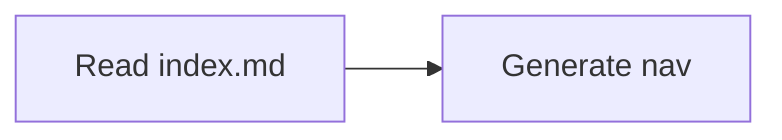

# Contributing to {{SITE_NAME}}

Ship documentation with the behavior it explains. Use the [docs toolchain guide](contributing/docs-toolchain.md) for setup and validation and [contributor guides](contributing/index.md) as the local map.

Agent working rules: `../AGENTS.md` (app-root source file).

## Authored and generated files

| Surface                                              | Owner and action                                                          |
| ---------------------------------------------------- | ------------------------------------------------------------------------- |
| `docs/**/*.md`, including `docs/**/index.md`         | Authored source; edit purpose and Contents maps directly.                 |
| `AGENTS.md` and this contributor guide               | Authored working rules and human guidance; keep their audiences separate. |
| `mkdocs.yml` outside `nav:`                          | Authored framework configuration.                                         |
| `mkdocs.yml` `nav:`                                  | Committed derived sidebar; regenerate with nav sync.                      |
| `site/`                                              | Generated site output; do not edit.                                       |
| `requirements.txt`, `setup-docs.sh`, package scripts | Authored toolchain; changing pins needs an explicit tooling review.       |

MkDocs 1.4.2 has no configurable rendering exclusion: non-reader pages leave nav/manifest but still render as routes. Do not promise private draft routes or add an exclusion plugin as an implicit repair.

This MkDocs/Material scaffold is **legacy**. [Material's upstream changelog](https://squidfunk.github.io/mkdocs-material/changelog/) states that it is in maintenance mode, with critical bug fixes and security updates through **May 5, 2027**, then upstream maintenance ends. The team identifies [Zensical](https://zensical.org/) as its maintained successor. This date applies to Material, not MkDocs core. Existing Python pins remain unchanged; the maintenance statement does not promise backports to these exact old pins. Plan an explicit tooling review before adopting this path for a new site.

## Navigation contract

Fresh scaffolds set `use_directory_urls: false` in `mkdocs.yml`. Pages use `.html` URLs: `contributing.md` renders as `contributing.html`, and the local map `contributing/index.md` renders as `contributing/index.html`. Keep both source files and `.md`-suffixed authored links; MkDocs resolves them to the distinct rendered destinations. Changing this setting requires reviewing published URLs and inbound links.

Every content directory has an authored `index.md` with a useful purpose paragraph and one `## Contents` local map. Prefer `.md` pages with nonempty `title` and `description` frontmatter and exactly one document H1. `overview.md` is deprecated.

Within `## Contents`, use dash-only links to sibling pages or child indexes, optionally followed by a description. A `### Label` starts a group and must contain at least one authored entry before the next group/end. Entries before the first group are ungrouped. A `*` or `+` link bullet, or an empty authored group, is an error naming the file and line. The map ends at the next level-two heading; fenced examples are ignored. A self-index link retains the existing landing-page behavior. Optional Markdown inventories keep deterministic fallback when Contents is missing; MkDocs nav sync needs authored maps to construct navigation. The pinned MkDocs build can still render pages absent from its navigation.

```markdown
## Contents

- [Start here](getting-started.md) - The first safe result.

### Contributor guides

- [Toolchain](contributing/index.md) - Local setup and authoring.
```

`documentation.navOwner: nav-sync` means nav sync owns derived navigation. With `hand-authored` or undeclared ownership, do not silently regenerate; agree the ownership/change first. Configured `documentation.nonReaderPaths` omits drafts/templates from navigation and manifests; an explicit Contents link does not override an exclusion. `documentation.excludes` affects only the manifest. Do not add an exclusion to hide an unlisted reader page.

## Add, move or rename a page

1. Read the nearest authored map and choose a path in its scope; create a child `index.md` when adding a directory.
2. Add useful title/description frontmatter, one H1, and the page's reader outcome. Use `.md`-suffixed source links such as `[Guide](guide.md)` and `[Section](section/index.md)`.
3. Update the nearest Contents map. For a move/rename, update both source and destination maps and every inbound link in the same change. Review old published URLs; agree a redirect or a static stub/recovery page when needed.
4. Refresh owned navigation, run the checks below and inspect the rendered links/navigation before committing. Never repair drift by hand-editing derived files.

## Supported Markdown features

Use the least complex layer that expresses the reader's need: **Markdown → existing transform → MDX**. Ordinary prose stays `.md`. Fumadocs MDX is for actual JSX/component needs; MkDocs does not compile MDX. MDX is excluded from OAT's Markdown manifest and the Fumadocs agent Markdown endpoints.

Tables, task lists, fenced code, callouts, Mermaid and `=== "Title"` tabs are supported by the configured framework pipeline. Tabs may contain links, GFM and nested tabs in Fumadocs. Use a language on every fence and `bash` for shell commands.

=== "Syntax"

    ````text
    === "Example"

        > [!NOTE]
        > Read the local map before editing.

        | Check | Result |
        | --- | --- |
        | Reader links | Resolve |

        ```bash
        pnpm docs:lint
        ```
    ````

=== "Rendered"

    === "Example"

        > [!NOTE]
        > Read the local map before editing.

        | Check | Result |
        | --- | --- |
        | Reader links | Resolve |

        ```bash
        pnpm docs:lint
        ```

Not configured: arbitrary custom components, executable notebooks, API playgrounds, diagram syntax validation or screenshot testing. Do not describe those as supported without an approved configuration and a working example. Check the actual package scripts: lint is {{LINT_STATUS}} and formatting is {{FORMAT_STATUS}}; disabled scripts only print a message.

## Diagrams and accessibility

Mermaid is the diagram source of truth. Important or phone-sized diagrams also get matching `<name>-light.svg` and `<name>-dark.svg` assets. Change the Mermaid and both SVGs in the same commit, preserving nodes, edges and labels. Each SVG uses `role="img"`, a descriptive `<title>` and `<desc>` (connected with `aria-labelledby`), a legible viewBox and readable labels. Keep image alt text concise, about 155 characters or less, and describe the diagram's meaning without inventing claims.

=== "Syntax"

    ````text
    === "Mermaid source"

        ```mermaid
        flowchart LR
          A[Read local map] --> B[Make a focused edit]
        ```
    ````

=== "Rendered"

    ```mermaid
    flowchart LR
      A[Read local map] --> B[Make a focused edit]
    ```

Put diagram assets under `docs/assets/diagrams/` and link relative to the source page. Keep both SVG variants with the source; automatic light/dark image selection is not configured in this MkDocs scaffold. Inspect theme contrast manually; do not claim the Fumadocs image/basePath behavior here.

## Installed plugins

### `search`

Adds full-text search to the generated docs site so readers can discover content without browsing the full tree.

### `git-revision-date`

Shows file revision dates using Git history, which helps surface stale pages during maintenance reviews.

### `macros`

Enables variable-style content reuse and small computed fragments inside MkDocs pages.

### `glightbox`

Adds lightbox behavior for linked images so diagrams and screenshots can be expanded in-place.

### `callouts`

Supports GitHub-style callout blocks in Markdown for note, warning, and tip content.

## Enabled Markdown extensions

### `admonition`

Supports MkDocs callout syntax:

```markdown
!!! note
Useful supporting context.
```

### `attr_list`

Lets you attach attributes such as classes or IDs to Markdown elements.

### `md_in_html`

Allows Markdown content inside raw HTML blocks when layout needs extra structure.

### `nl2br`

Treats single newlines as line breaks in rendered output.

### `pymdownx.caret`, `pymdownx.mark`, `pymdownx.tilde`

Adds inline formatting helpers for insertions, highlights, and strikethrough-like syntax.

### `pymdownx.details`

Supports collapsible details blocks for optional reference content.

### `pymdownx.emoji`

Enables emoji shortcodes and richer emoji rendering.

### `pymdownx.inlinehilite`

Adds inline code highlighting helpers for short syntax examples.

### `pymdownx.highlight`

Provides fenced code block highlighting.

### `pymdownx.snippets`

Supports file and snippet inclusion patterns for reusable documentation fragments.

### `pymdownx.superfences`

Extends fenced code support and enables custom fences such as Mermaid:

````text

````

### `pymdownx.tabbed`

Supports tabbed content blocks for related workflows or platform variants.

### `toc`

Adds table-of-contents anchors and permalinks for headings.
